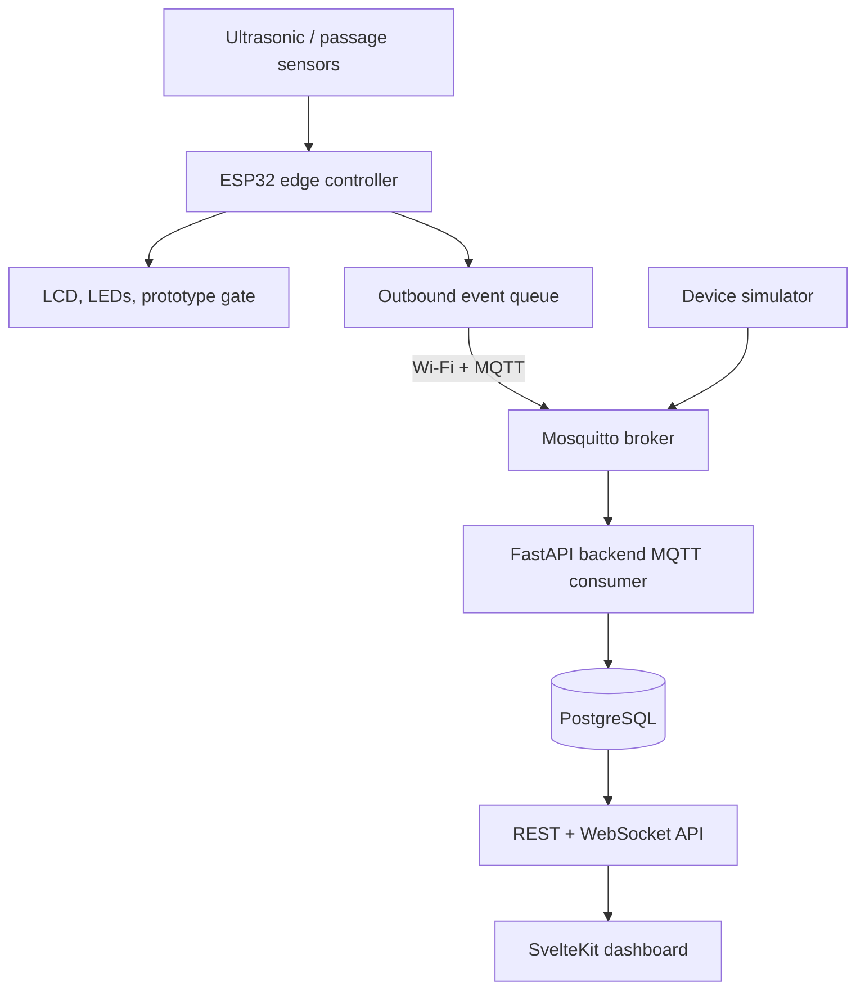
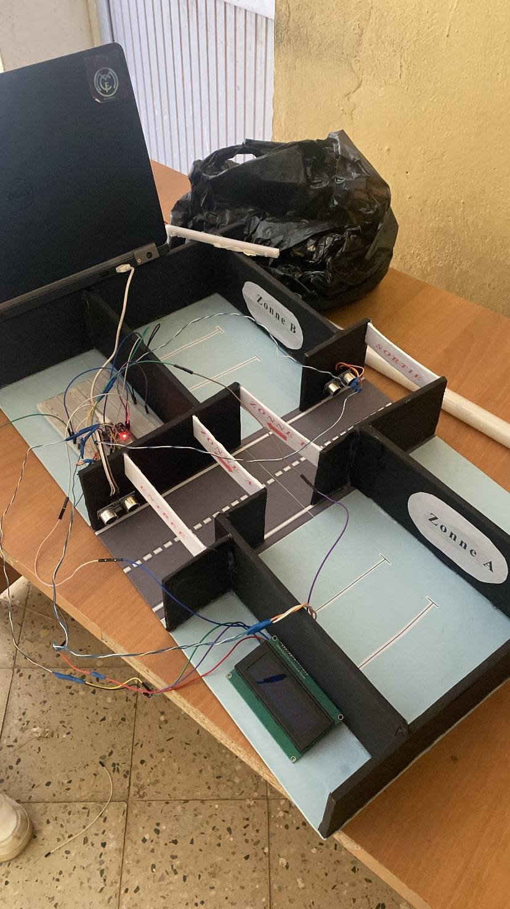

# SmartPark-IoT

<div align="center">


**An offline-first smart parking platform: ESP32 firmware, MQTT, FastAPI, PostgreSQL, SvelteKit — and eventually Flutter.**

</div>

> **Current milestone: M1B — reliable passage detection, persistence & simulation.**
> The working software today is the *modular V2 firmware* (M1A architecture +
> M1B two-point passage FSM, obstruction-guarded close, NVS persistence, native
> test suite, Wokwi simulation project). The original V1 Arduino firmware is
> archived under `legacy/v1/`. The MQTT transport, backend, database, dashboard,
> M5 simulator and mobile app are **planned, not implemented** — see
> [the feature status table](#-feature-status) below.

---

## Overview

Finding a parking space is frustrating when drivers cannot see whether spaces are
free or which way to go inside the lot. SmartPark-IoT evolves an academic ESP32
prototype into a professional, open-source IoT platform that counts vehicles,
controls a demonstration gate, shows free-space guidance on-site, and — from M2
onward — reports occupancy over MQTT to a local-first backend that keeps working
when the internet does not.

**Design principles** (full rationale in [the blueprint](docs/SMARTPARK_V2_COMPLETE_PROJECT_BLUEPRINT.md)):

- **Offline-first** — the ESP32 keeps sensing and running safe local gate logic
  with no Wi-Fi, broker or cloud available.
- **Honest states** — occupancy can be *unknown*; the system must never invent
  free spaces after a reboot or a sensor failure.
- **Evidence over claims** — features are only "done" when tests, logs or
  recorded hardware results back them up.

## 🚦 Feature status

Statuses reflect what is **in this repository right now**, not what is planned.

| Feature | Status | Evidence / notes |
|---|---|---|
| Vehicle counting (entry/exit) | 🟡 M1B: two-point logic ready, manual reconciliation on hardware | approach **never** auto-counts; ordered two-point FSM v2 + IR beams on GPIO 4/16 designed but **not procured** ([pinmap §9](docs/hardware/pinmap-v2.md), [m1b](docs/milestones/m1b.md)); no hardware re-validation |
| Automatic barrier (SG90 servo) | 🟡 M1B FSM, obstruction-guarded close | closing needs observed valid-FREE lane **and** a fresh `CLEAR` on GPIO 14 every tick; open input fails toward BLOCKED = never closes; obstruction sensor itself still absent ([pinmap §12](docs/hardware/pinmap-v2.md)) |
| LCD guidance + status LEDs | 🟡 M1A logic (host-tested) | 17-char overflow fixed in `display_manager` (covered by the native suite); untested on hardware |
| Zone A / Zone B occupancy LEDs | 🟡 M1A logic (host-tested) | unified hysteresis thresholds; blink = `UNKNOWN`/`FAULT` |
| PlatformIO build + CI | ✅ Working | [`firmware-ci`](.github/workflows/firmware-ci.yml): compile + native tests + cppcheck (3-job version green since [M1A run #2](https://github.com/abderaoufsec/SmartPark-IoT/actions/runs/40524020932); unchanged in M1B) |
| Direction-aware passage detection | 🟡 M1B logic + simulation, hardware absent | ordered two-point FSM v2 unit-tested; second points (IR beams, GPIO 4/16) selected, not procured — unwired inputs read FREE so counts stay reconciliation-only ([pinmap §11](docs/hardware/pinmap-v2.md)) |
| Sensor cross-talk-safe triggering | 🟡 M1A code, not measured | independent TRIGs + 80 ms staggered slots; acoustic verification remains M6 |
| Persistent occupancy across reboot | 🟡 M1B logic (host-tested) | CRC-valid NVS record restores the exact count (flagged *recovered*); corrupt/missing → `UNKNOWN`, never clamped; physical power-cycle evidence = M6 |
| Non-blocking, obstruction-aware gate FSM | 🟡 M1B logic | no `delay()` in `loop()`; fresh-CLEAR guarded close + mid-sweep abort; obstruction *sensor* = M6 |
| Wokwi simulation (headless) | 🟡 M1B configured | `simulation/wokwi/` runs the real `firmware.bin`; `lint` green (0 warnings); scenario execution **pending `WOKWI_CLI_TOKEN`** |
| Unit test suite (host, no hardware) | ✅ Working (M1B) | **59 tests** (41 M1A + 18 M1B), `pio test -e native`, green locally; CI runs them on every push |
| Wi-Fi + MQTT + offline event queue | ⬜ Planned M2 | [roadmap](docs/milestones/roadmap.md) |
| FastAPI + PostgreSQL backend | ⬜ Planned M3 | [roadmap](docs/milestones/roadmap.md) |
| SvelteKit operator dashboard | ⬜ Planned M4 | [roadmap](docs/milestones/roadmap.md) |
| Device simulator + end-to-end demo | ⬜ Planned M5 | [roadmap](docs/milestones/roadmap.md) |
| Hardware calibration & measured results | ⬜ Planned M6 | no measured results exist yet |
| Flutter mobile app | ⬜ Planned (M10, optional) | explicitly out of MVP scope |

Legend: ✅ verified working · 🟡 code exists, limited/no re-verification · ❌ known gap · ⬜ planned.

## 🏗 Architecture

Target architecture for the MVP (from [`docs/architecture/overview.md`](docs/architecture/overview.md)):



**What exists today (M0–M1B):** the *ESP32 edge controller* box — the modular
V2 firmware (`lib/smartpark_core` + thin Arduino HAL), a 59-test host suite and
a Wokwi simulation project that executes the same binary. Everything right of
the queue is planned work.

The ESP32 always owns physical safety: losing the network must never stop local
sensing or make the gate behave unsafely.

## 🛠 Hardware (V1 prototype)

| Component | Quantity |
|---|---:|
| ESP32 development board | 1 |
| HC-SR04 ultrasonic sensor | 4 |
| SG90 servo motor | 1 |
| 16×2 I2C LCD (address 0x27) | 1 |
| LEDs (green, red, zone A, zone B) | 4 |
| Breadboard, resistors, jumper wires, USB cable | — |

### Pin assignment (as implemented in V1)

| Device | GPIO | Warning |
|---|---|---|
| Servo (barrier) | 13 | PWM only; see power notes in audit |
| Green LED / Red LED | 26 / 27 | |
| Zone A LED / Zone B LED | 25 / 33 | |
| Shared ultrasonic TRIG | 3 | **Conflicts with UART0 RX** (Serial RX unusable) |
| Echo: entry / zone A / zone B / exit | 15 / 2 / 4 / 5 | **GPIO 2 & 5 are boot-strap pins; 5 V echo not level-shifted** |
| LCD SDA / SCL | 21 / 22 | ESP32 default I2C pins |

> ⚠️ **Before powering hardware:** read [`docs/hardware/v1-audit.md`](docs/hardware/v1-audit.md).
> The V1 wiring has unresolved electrical risks (5 V echo into 3.3 V-only GPIOs,
> boot-strap pin usage, UART conflict) and the barrier close logic is not safe
> for a real gate. This is a supervised desk demonstrator, not a deployed barrier.

## 📸 Original V1 prototype

Physical model built for the original academic project by
[Mehdi Koceir](https://github.com/MehdiKoceir) (photo preserved from the
[original repository's README](https://github.com/MehdiKoceir/Parking-intelligent-)):



*This photo comes from the original V1 project. It was not produced during the
SmartPark-IoT M0 milestone, and no new hardware results exist yet.*

## 🚀 Quick start (firmware)

### Prerequisites

- Git
- Python 3.10+ with [PlatformIO Core](https://docs.platformio.org/en/latest/core/installation.html)
  (`pip install platformio`) — or the PlatformIO IDE extension for VS Code
- An ESP32 Dev Module (or set `board` in `firmware/esp32/platformio.ini`)

### Build

```bash
git clone https://github.com/abderaoufsec/SmartPark-IoT.git
cd SmartPark-IoT/firmware/esp32
pio run                # compile with pinned toolchain & libraries
pio test -e native     # 59 host unit tests, no hardware needed
pio run -t upload      # flash the board
pio device monitor     # 115200 baud serial output
```

Optional (simulation, no board needed): `wokwi-cli ../../simulation/wokwi lint`
— see [`simulation/wokwi/README.md`](simulation/wokwi/README.md) for the
scenario commands (they require a `WOKWI_CLI_TOKEN`).

All platform and library versions are **pinned** in
[`firmware/esp32/platformio.ini`](firmware/esp32/platformio.ini) — two
developers get the same build. CI runs the same `pio run` on every push and pull
request.

## 📂 Repository structure

```text
SmartPark-IoT/
├── README.md                     ← you are here
├── LICENSE  (MIT)  CONTRIBUTING.md  SECURITY.md  CHANGELOG.md
├── .gitignore  .editorconfig  .gitattributes  .env.example
├── .github/
│   ├── workflows/firmware-ci.yml ← PlatformIO compile on push/PR
│   └── PULL_REQUEST_TEMPLATE.md
├── firmware/esp32/               ← PlatformIO project (V2 modular firmware + 59 native tests, M1A/M1B)
│   ├── platformio.ini
│   └── src/main.cpp
├── docs/
│   ├── SMARTPARK_V2_COMPLETE_PROJECT_BLUEPRINT.md  ← full spec
│   ├── architecture/  requirements/  hardware/
│   ├── milestones/  decisions/  images/
├── legacy/v1/                    ← immutable archive of the original project
│   ├── parking_intelligent.ino
│   ├── original-report.pdf
│   └── README.md                 ← provenance & SHA-256 checksums
├── simulation/wokwi/             ← Wokwi simulation project (M1B: diagram, scenarios)
├── backend/      ← planned M3   frontend/   ← planned M4
├── mobile/       ← planned M10 (optional); M5 simulator extends simulation/
```

The `backend/` and `frontend/` directories do **not** exist yet on purpose —
no empty placeholder code. `simulation/wokwi/` exists (M1B); the M5 device
simulator will join it later.

## 📚 Documentation

| Document | Purpose |
|---|---|
| [Project blueprint](docs/SMARTPARK_V2_COMPLETE_PROJECT_BLUEPRINT.md) | Complete V2 specification & research basis |
| [Architecture overview](docs/architecture/overview.md) | Components, trust boundaries, data flow |
| [Requirements](docs/requirements/requirements.md) | FR/NFR IDs used in issues & tests |
| [Hardware & V1 audit](docs/hardware/v1-audit.md) | Firmware bugs, electrical risks, unknowns |
| [Roadmap M0–M10](docs/milestones/roadmap.md) | Milestones and exit gates |
| [M0 status](docs/milestones/m0.md) | What M0 delivered + acceptance checklist |
| [M1A status](docs/milestones/m1a.md) | Firmware architecture, safe hardware design, native tests |
| [M1B status](docs/milestones/m1b.md) | Passage v2, persistence, obstruction guard, simulation |
| [Wokwi simulation](simulation/wokwi/README.md) | How to lint/run the headless simulation |
| [Decision log](docs/decisions/0001-baseline.md) | Why fork, why monorepo, baseline hashes |

## 🤝 Contributing

Read [`CONTRIBUTING.md`](CONTRIBUTING.md) for branch/commit/PR rules and
[`SECURITY.md`](SECURITY.md) for reporting vulnerabilities **and for the
prototype safety limitations**. Changes are reviewed before merging; see the
roadmap for which milestone owns which work.

## 👨‍💻 Authors & attribution

- **Original academic project:** [Mehdi Koceir](https://github.com/MehdiKoceir) —
  Master's student in Computer Systems & Networks (SIR), University of Blida.
  Source: [MehdiKoceir/Parking-intelligent-](https://github.com/MehdiKoceir/Parking-intelligent-)
- **SmartPark-IoT platform modernization:** [abderaoufsec](https://github.com/abderaoufsec)

## 📄 License

[MIT](LICENSE) — chosen by the maintainers during the M0 review
(2026-10-27). The original README used an MIT badge even though no
`LICENSE` file ever existed in the upstream repository; that gap is now closed
for real. The copyright notice credits both the original author and the
modernization contributors — if either author prefers a different license, it
must be changed jointly by PR before the first release.
