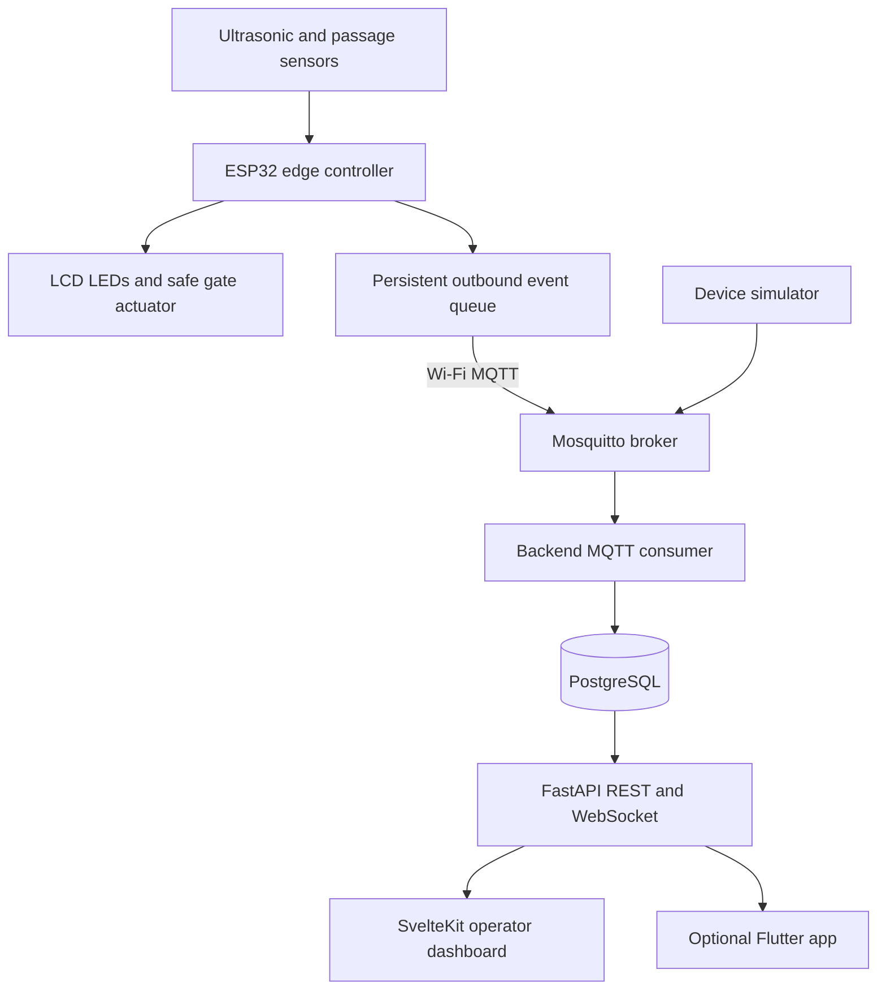

# SmartPark V2 — Complete Project Blueprint

**Version:** 1.0 planning baseline  
**Date:** 2026-10-27  
**Owners:** Two student collaborators (original project by Mehdi and teammate)  
**Status:** Specification, not an implementation report  
**Source:** https://github.com/MehdiKoceir/Parking-intelligent-

> This document is a build specification and execution handbook. A feature is not implemented merely because it is specified here. Confirm each milestone through tests and documented evidence.

## Contents
1. Research and competitive landscape
2. Project vision and boundaries
3. Original V1 audit
4. Requirements and acceptance criteria
5. System architecture
6. Firmware design
7. Hardware and electrical engineering
8. MQTT and offline synchronization
9. Backend and data model
10. Web dashboard and mobile roadmap
11. Security and privacy
12. Testing and measurement
13. Repository and collaboration
14. Local development and deployment
15. Complete milestone roadmap M0–M10
16. Detailed M0 execution
17. Risks, costs and decision log
18. Definition of done and final demonstration
19. Research references

---

## 1. Research and competitive landscape

### 1.1 Comparable open-source systems

| Project | Source | Relevant capabilities | Lessons / gaps to investigate |
|---|---|---|---|
| IoT-Smart-Parking-System | https://github.com/thej-alt/IoT-Smart-Parking-System | ESP32, ultrasonic sensing, MQTT, Node-RED, environmental monitoring | Simple IoT pipeline; evaluate whether offline replay and safe barrier logic are addressed |
| NiflheimDevs/SmartParking | https://github.com/NiflheimDevs/SmartParking | ESP32, MQTT, Go, PostgreSQL, React, RFID, JWT | Closest full-stack reference; compare boundaries, authorization and operational reliability |
| Kadacheahmedrami/smart-parking | https://github.com/Kadacheahmedrami/smart-parking | Six ultrasonic sensors, ESP32, JSON API, Next.js | Per-space monitoring and sensor failure handling |
| hmei3-hash/smart-parking-monitor | https://github.com/hmei3-hash/smart-parking-monitor | ESP32-S3-CAM nodes, edge inference, gateway, fusion, MQTT | Offline gateway and uncertainty handling; advanced, not an MVP dependency |
| adarshsrivastav23905/Smart-Parking-System-Using-Ultrasonic-Sensors | https://github.com/adarshsrivastav23905/Smart-Parking-System-Using-Ultrasonic-Sensors | Wokwi, PlatformIO, 4-space simulation, servo, web UI | Reproducible simulated demos; hardware validation explicitly separate |
| Parklio | https://docs.parklio.com/ | Commercial connected barriers, occupancy and API | Reference for product boundaries, device authorization and remote commands |

### 1.2 Research conclusion

Smart parking is not a new concept. Do not claim novelty for occupancy detection, MQTT, dashboards, or automatic gates. Differentiate through measurable reliability, offline-first local control, event reconciliation, confidence-aware occupancy, reproducible simulation, test evidence, and realistic deployment constraints. Avoid copying external code without inspecting each repository's actual license and attribution requirements. Research comparison is based on public project documentation, not independent validation of their implementation quality.

### 1.3 Research questions to validate experimentally

- Can entry/exit counting remain accurate with stopped, reversed, or closely spaced vehicles?
- How much sensor cross-talk occurs with the current shared-trigger design?
- What happens when power fails mid-passage?
- Can events be replayed after Wi-Fi loss without double counting?
- How quickly does the dashboard show a confirmed occupancy change?
- How does the system distinguish *empty*, *occupied*, *unknown* and *sensor offline*?
- Does barrier operation remain safe with backend and MQTT disconnected?

## 2. Project vision and boundaries

**Mission:** Build an extensible, low-cost smart parking platform that reliably senses and records occupancy, locally manages a prototype gate, guides vehicles, and exposes secure, near-real-time management interfaces.

**Target users:** facility operators, administrators, maintenance technicians; drivers only after a public interface is justified.

**Primary deployment:** a single demonstrator facility with 6 nominal spaces and zones A/B. Scale-out is designed, not promised as tested.

**MVP (P0):** firmware reliability, event-driven MQTT, offline operation, PostgreSQL backend, live authenticated dashboard, diagnostics, simulator, documentation, CI and physical demonstration.

**P1:** multi-controller, per-space sensors, RFID/QR authorization, historical reporting, managed remote actions.

**P2:** Flutter driver app, reservations, demand forecasting, LPR, payments. These are optional separate work packages, not prerequisites for the core system.

**Out of scope for prototype:** unsupervised operation of a full-size road barrier, handling financial payments, collecting license plates, and asserting compliance with any safety standard without professional verification.

## 3. Original V1 audit

Source files observed on default branch: `parking_intelligent.ino`, duplicate `pasted_content_19.txt`, README and `Smart_Parking_System_avec_Guidage_Directionnel (1).pdf`. README references directories not present in the observed root listing. Current source uses ESP32, four ultrasonic sensors (entry, exit, zone A, zone B), SG90, 16x2 I2C LCD, four LEDs, fixed capacity 6, debounce and sequential reads.

**Critical findings:**
1. `PIN_TRIG=3` conflicts with UART0 RX on common ESP32 boards; pin assignment must be redesigned against exact board datasheet.
2. One shared trigger pulses all four transducers, so sequential echo reads do not eliminate acoustic cross-talk.
3. Entry increments when a vehicle is detected approaching, rather than on verified crossing; the count can drift.
4. Exit has the same detection weakness; a single sensor does not establish direction.
5. `pulseIn` can block, servo motion uses `delay`, and gate wait blocks loop execution.
6. Timeout `999` is interpreted as a free zone in the guidance logic; invalid measurements need their own state.
7. Vehicle count resets on reboot; persistent state and recovery are absent.
8. Servo is commanded closed after a fixed delay with no beam/obstruction confirmation; unsafe for real gates.
9. Current LCD may overflow 16 columns on some composed messages; bound and clear output.
10. No Wi-Fi, authentication, MQTT, backend, dashboard, database, automated tests or documented deployment in firmware.
11. README shows MIT badge without a repository license file; authors must agree on actual licensing.
12. ESP32 GPIO 2 and other boot-strapping pins require board-specific review. HC-SR04 ECHO at 5V must not connect directly to 3.3V-only GPIO; use validated level shifting.

**Audit caveat:** Findings come from source inspection, not live electrical measurements or an independently reproduced firmware build.

## 4. Requirements and acceptance criteria

Use IDs in GitHub issues and tests.

### Functional P0

- **FR-001:** Read each sensor without uncontrolled cross-talk; label invalid/time-out measurements UNKNOWN.
- **FR-002:** Filter noise using configurable hysteresis and consecutive stable readings.
- **FR-003:** Confirm vehicle passage through a direction-aware sensing arrangement; never count mere approach as passage.
- **FR-004:** Reject or defer admission when capacity is exhausted or reliable availability is unknown.
- **FR-005:** Gate finite-state machine: CLOSED, OPENING, OPEN, CLOSING, BLOCKED, FAULT, MANUAL; no unsafe timed close.
- **FR-006:** Operate local sensing and safe gate logic with Wi-Fi and backend unavailable.
- **FR-007:** Persist necessary counters and event queue across expected restarts; define crash consistency behavior.
- **FR-008:** Publish validated occupancy events and heartbeat over MQTT with durable IDs and sequence numbers.
- **FR-009:** Backend deduplicates repeated events and records ingestion failures.
- **FR-010:** Authenticated dashboard shows facility, zone, capacity, confidence, device health, history and alerts.
- **FR-011:** Operator can reconcile counts with reason and audit log; no silent corrections.
- **FR-012:** Simulated sensor/device events exercise the same backend contract as physical hardware.

### Nonfunctional P0 — initial engineering targets, subject to validation

- **NFR-001:** Local gate safety independent of network connectivity (mandatory behavior).
- **NFR-002:** In a healthy LAN, 95% of confirmed events visible on dashboard within 2 seconds (measurement target).
- **NFR-003:** No duplicate database event rows after at-least-once replay (invariant).
- **NFR-004:** Reboot and reconnect recover without silently inventing free spaces (invariant).
- **NFR-005:** Local simulation reproducible with documented commands on Windows 11 + WSL2 or Linux.
- **NFR-006:** API and broker reject unauthorized access; secrets never committed.
- **NFR-007:** CI validates builds, tests, formatting and migrations before merging.
- **NFR-008:** Logs include event/device IDs and are scrubbed of secrets.

### Acceptance matrix

| Requirement | Evidence |
|---|---|
| FR-003 | Approach/reverse/crossing tests and count invariants |
| FR-005 | Barrier obstruction tests; emergency/manual recovery |
| FR-006 | Disconnect broker/router; show local operation |
| FR-007 | Power-cycle/reboot recovery report |
| FR-009 | Replay same event 100 times; exactly one stored logical event |
| FR-010 | Screen recording + API test of live status |
| NFR-002 | Timestamped 100+ event latency sample and percentile |
| NFR-006 | Negative authentication/authorization tests |

## 5. System architecture



**Ownership:** ESP32 owns physical safety and sensing; backend owns normalized event records and server-side read models; database owns persistence; dashboard is a client, not a safety controller. Network loss must not cause local unsafe actuation.

**Deployment variants:** Development uses Docker Compose on a laptop. Pilot deployment may use a local mini-PC or Raspberry Pi-class gateway plus ESP32 controllers, with local broker and backend; optional cloud sync is a later architecture decision. Internet connectivity is not a prerequisite for local operations.

**Failure modes:** sensor failure -> UNKNOWN, gate conservative; broker down -> queue events and continue safe local mode; duplicate MQTT delivery -> idempotent ingest; stale controller -> dashboard OFFLINE; DB down -> backend returns unavailable and buffers only if explicit durable design exists; power loss -> safe actuator behavior, recover persisted state, require reconciliation when confidence is lost.

## 6. Firmware design

Use PlatformIO, C++ modules, board-specific pin map, dependency lock/pins and testable logic separated from Arduino I/O.

Suggested components: `SensorReader`, `SensorFilter`, `PassageDetector`, `OccupancyManager`, `BarrierController`, `DisplayController`, `PersistentEventQueue`, `MqttTransport`, `ConfigStore`, `HealthMonitor`, `ClockService`.

### State machines

**Sensor:** INIT -> VALID_FREE / VALID_OCCUPIED / UNKNOWN / FAULT; stale readings transition to UNKNOWN. Thresholds must be calibrated to physical geometry and use hysteresis.

**Passage:** IDLE -> APPROACH -> CROSSING -> CONFIRMED or CANCELLED; require two ordered sensing points or equivalent independent crossing evidence. A single entry proximity sensor is insufficient for strong confirmation.

**Barrier:** CLOSED -> OPENING -> OPEN -> CLOSING -> CLOSED; obstruction causes BLOCKED/OPEN or FAULT; loss of position feedback yields FAULT. Hardware interlocks and supervised real-world installation are separate requirements beyond an SG90 demo.

**Occupancy:** use bounded count `0..capacity`; never silently clamp invalid event streams without emitting an inconsistency alert. If reboot state is uncertain, mark occupancy UNKNOWN until reconciled.

### Firmware development sequence

1. Record exact ESP32 board model and all wiring.
2. Design safe voltage conversion and supply distribution; do not power servo from an overloaded GPIO/3.3V rail.
3. Establish PlatformIO compile-only baseline with unchanged legacy behavior.
4. Create pin map and replace UART/boot-conflicting assignments.
5. Write pure logic unit tests for sensor classification, hysteresis, state transitions and count bounds.
6. Replace blocking operations with timed state machines.
7. Test each ultrasonic sensor separately; choose independently triggered sensors with isolation spacing.
8. Add passage-confirmation sensing, then gate obstruction sensing.
9. Add persistence, Wi-Fi and MQTT only after local tests pass.
10. Run soak tests and collect memory, reset, uptime, detection accuracy and failure logs.

## 7. Hardware and electrical engineering

### Existing prototype inventory

ESP32 development board x1, HC-SR04 x4, SG90 x1, 16x2 I2C LCD x1, status LEDs x4, breadboard, resistors, jumpers, USB power. Confirm physical inventory rather than assuming README quantities are complete.

### Recommended staged upgrades

- **Required for safe signal levels:** suitable resistive dividers or logic-level shifters for 5V ECHO, correctly rated supply, common reference ground and decoupling.
- **Required for reliable passage:** second sensor per direction or alternative beam/position sensors; verify physical arrangement.
- **Required for safer prototype gate:** obstruction detector, manual stop/override, safe power and physical limit behavior.
- **Optional:** individual space sensors, RFID reader, extra ESP32 nodes, local gateway, enclosure, display upgrades.

### Electrical checklist

- Document ESP32 exact board and pin capabilities; do not blindly copy GPIO table from V1.
- Confirm each HC-SR04 ECHO voltage and 3.3V interface.
- Ensure servo power supply handles stall current; common ground and noise suppression.
- Confirm LCD module voltage and I2C pull-ups compatible with ESP32 logic.
- Ensure no exposed moving parts during testing; miniature barrier only.
- Provide wiring diagram, photos, pin table, power budget and measured supply voltage.

### Costing method

Do not claim current Algerian prices without supplier quotes. Maintain `docs/hardware/bom.csv` with component, quantity, supplier, date, DZD unit price, availability, alternative and procurement status. Price at least two alternatives for each major new component.

## 8. MQTT and offline synchronization

### Topic convention

```
smartpark/v2/facilities/{facilityId}/devices/{deviceId}/events
smartpark/v2/facilities/{facilityId}/devices/{deviceId}/state
smartpark/v2/facilities/{facilityId}/devices/{deviceId}/health
smartpark/v2/facilities/{facilityId}/devices/{deviceId}/commands
smartpark/v2/facilities/{facilityId}/devices/{deviceId}/acks
```

### Event example

```json
{
  "schema_version": 1,
  "event_id": "esp32-001-boot42-000018",
  "device_id": "esp32-001",
  "boot_id": "boot42",
  "sequence": 18,
  "type": "vehicle_entered",
  "uptime_ms": 184200,
  "data": {"gate_id": "entry-01", "confidence": "confirmed"}
}
```

Do not use the example boot ID algorithm without ensuring uniqueness across reboots; prefer durable monotonic sequence or robust unique ID generation. Backend adds `received_at` and treats untrusted device wall-clock timestamps cautiously.

### Delivery rules

- MQTT QoS 1 is appropriate for many telemetry events, but it does **not** guarantee exactly-once database effects.
- Event IDs are unique, and backend insertion is idempotent (`UNIQUE(device_id,event_id)`).
- Outbound queue records are persisted before publishing where feasible; remove only after application-level acknowledgment or a documented recovery strategy.
- Queue capacity and flash write endurance must be measured; define overflow alert and fallback.
- Retained MQTT messages are appropriate for latest state, not for an unbounded event log.
- Last Will and heartbeat report connectivity; timeout is authoritative for stale devices.
- Device credentials, ACLs and TLS are required before deployment beyond a trusted isolated lab.

### Test scenarios

Offline for 30 seconds / 10 minutes, reconnect, reboot during queued publish, replay identical event, reordered delivery, corrupted payload, unknown device, expired command, broker restart, backend restart, queue full. Expected outcomes must be written before running tests.

## 9. Backend and data model

**Stack:** FastAPI, Pydantic, SQLAlchemy, Alembic, PostgreSQL, MQTT client, pytest. Use a modular monolith rather than microservices initially.

### Data entities

- `facilities(id, name, timezone, status)`
- `zones(id, facility_id, label, capacity)`
- `parking_spaces(id, zone_id, label, status, last_observed_at)`
- `devices(id, facility_id, hardware_id, type, last_seen_at, status)`
- `sensors(id, device_id, sensor_type, position, calibration_json, health)`
- `parking_events(id, event_id, device_id, boot_id, sequence, type, payload_json, received_at)`
- `occupancy_snapshots(id, facility_id, zone_id, occupied, capacity, confidence, observed_at)`
- `users(id, email, password_hash, status)`
- `memberships(user_id, facility_id, role)`
- `audit_logs(id, actor_id, action, object_type, object_id, details_json, occurred_at)`
- `device_commands(id, device_id, command_type, status, expires_at, requested_by, created_at)`

Migration files are the source of truth. Foreign keys, check constraints and uniqueness must be tested. Avoid recording unnecessary personal driver data.

### REST endpoints (proposed)

```
GET    /api/v1/health
POST   /api/v1/auth/login
GET    /api/v1/me
GET    /api/v1/facilities
POST   /api/v1/facilities
GET    /api/v1/facilities/{id}/overview
GET    /api/v1/facilities/{id}/zones
GET    /api/v1/facilities/{id}/spaces
GET    /api/v1/facilities/{id}/events
GET    /api/v1/facilities/{id}/devices
GET    /api/v1/facilities/{id}/analytics
POST   /api/v1/facilities/{id}/reconciliations
POST   /api/v1/devices/{id}/commands
GET    /api/v1/audit-logs
WS     /api/v1/ws/facilities/{id}
```

Authentication and role checks apply to every non-public resource. Use pagination, input validation, structured errors, API versioning, request IDs and rate limiting. Device commands must be scoped, expiring, logged and validated locally; no unguarded open/close endpoint.

### Backend implementation order

1. Project skeleton, lint/test tools and environment settings.
2. PostgreSQL connection and first migration.
3. Device/facility/zone models and seed demo data.
4. MQTT consumer and schema validation.
5. Transactional idempotent event ingestion.
6. Occupancy read model and reconciliation workflow.
7. REST APIs and OpenAPI schema.
8. Authentication and facility-scoped authorization.
9. WebSocket updates and disconnection handling.
10. Integration, security and performance tests.

## 10. Web dashboard and mobile roadmap

**Stack:** SvelteKit, TypeScript, Tailwind CSS, accessible components, typed API client, Playwright and Vitest.

### Screens

1. Login and session recovery.
2. Facility overview: total capacity, known occupied, free, unknown, utilization.
3. Zone/space map: color + text states (do not rely on color alone).
4. Live event timeline with timestamps and device IDs.
5. Device health: heartbeat, firmware version, last seen, sensor faults.
6. Alerts: open, acknowledged, resolved.
7. Historical charts: occupancy, peaks, anomalies, connectivity.
8. Operator reconciliation with audit trail.
9. Facility/zone/device configuration with role restrictions.
10. Read-only demonstration mode using simulator-generated data.

**UX rules:** distinguish unknown from free; show data freshness; responsive desktop/mobile layout; keyboard accessibility; loading/empty/error states; no fake live status when disconnected.

**Flutter P2:** driver-facing read-only availability first; reservations only after physical allocation semantics and expiry rules are defined. No mobile application in P0.

## 11. Security and privacy

### Threat model

Assets: barrier control, parking availability integrity, device credentials, operator accounts, audit logs. Adversaries: unauthorized LAN clients, compromised devices, stolen credentials, replayed MQTT messages, malicious API clients.

Controls:
- MQTT authentication, topic-level ACLs and TLS in deployed environments.
- Device identity per controller; secrets stored outside Git.
- Signed or otherwise authenticated firmware update plan for later production hardening.
- Backend authorization by facility and role; least privilege.
- Short-lived authenticated command requests, IDs, acknowledgments, replay prevention and local safety validation.
- Password hashing with current accepted password hashing libraries; secure cookie/session strategy.
- Input validation, dependency scanning, secret scanning, rate limiting and security logging.
- Backups with restore tests, secret rotation and incident response notes.
- Privacy minimization; do not collect license plates or personal identifiers for MVP.

**Deployment warning:** prototype servo hardware is not a certified barrier. Professional safety and electrical assessment is necessary before real vehicle access control.

## 12. Testing and measurement

### Test pyramid

- **Unit:** sensor classification, filtering, state machines, occupancy bounds, event IDs, API validation.
- **Integration:** MQTT -> consumer -> PostgreSQL -> API; migrations; authorization.
- **End-to-end:** simulator -> dashboard updates; reconnect and reconciliation.
- **Hardware-in-loop:** real ESP32, sensors, servo and controlled obstacle scenarios.
- **Resilience:** disconnects, power loss, duplicate/reordered events, sensor stuck high/low, broker restarts.
- **Security:** anonymous access, wrong role, spoofed device, replayed/expired commands, malformed payloads.

### Metrics

Detection precision/recall, false-entry count per 100 trials, missed exits, occupancy count drift, event latency p50/p95/p99, recovery time, replay duplicate rate, device uptime, queue loss, heap usage, sensor error frequency. Report conditions and sample size, not only headline numbers.

### Example validation scenarios

| ID | Scenario | Expected result |
|---|---|---|
| T01 | Car approaches then reverses | No confirmed entry |
| T02 | One car passes entry completely | One entry event |
| T03 | Two close vehicles | Distinct verified passages or explicit uncertain state |
| T04 | Full parking | Entry denied by local controller |
| T05 | Sensor times out | UNKNOWN and health alert |
| T06 | Barrier obstructed | Stop/reverse or safe fault per verified hardware design |
| T07 | Wi-Fi lost | Local operation, queued events |
| T08 | Reconnect and replay | No duplicate logical events |
| T09 | ESP32 reboot | Safe startup, recovered or unknown occupancy |
| T10 | Unauthorized MQTT client | Connection/publish denied |
| T11 | Unauthorized admin API | HTTP 401/403 |
| T12 | Backend disconnected | UI shows stale data, not fabricated freshness |

## 13. Repository and collaboration

### Fork workflow

1. Open `https://github.com/MehdiKoceir/Parking-intelligent-/fork` and select the destination GitHub account.
2. Clone your fork (replace account if necessary):

```bash
git clone https://github.com/abderaoufsec/Parking-intelligent-.git
cd Parking-intelligent-
git remote add upstream https://github.com/MehdiKoceir/Parking-intelligent-.git
git remote -v
```

3. Preserve V1 in the fork using a tag created at the known baseline commit (do not assume you can push tags to Mehdi's repository).
4. Create `develop` in the fork and use PRs into it; merge releases to `main` after tests.
5. Invite Mehdi to collaborate on the fork, or agree to use an organization-owned repository for shared ownership.
6. Pull upstream changes selectively; do not overwrite V2 without review.

**Ownership note:** GitHub fork settings and branch protection capabilities vary; configure what the account/repository supports. Keep original authorship in README, commit history and license notices.

### Target monorepo

```text
Parking-intelligent-/
  README.md
  LICENSE
  CONTRIBUTING.md
  SECURITY.md
  CHANGELOG.md
  .env.example
  .editorconfig
  .gitignore
  .github/workflows/
  .github/ISSUE_TEMPLATE/
  firmware/esp32/{platformio.ini,include/,src/,lib/,test/}
  backend/{app/,migrations/,tests/,pyproject.toml}
  frontend/web/{src/,static/,tests/}
  mobile/flutter/                  # P2, create only when needed
  infrastructure/{docker/,mosquitto/,monitoring/}
  simulation/{wokwi/,device-simulator/,scenarios/}
  docs/{architecture/,hardware/,protocols/,api/,testing/,milestones/,decisions/}
  legacy/v1/{parking_intelligent.ino,original-report.pdf}
  compose.yaml
```

Avoid committing empty placeholder directories unnecessarily. Preserve original documents and code verbatim under `legacy/v1/` and record original SHA-256 hashes. Remove redundant root copies only after verification and in a reviewed commit.

### Branch and PR conventions

- `main`: reviewed releases.
- `develop`: integration.
- `feature/<issue>-description`, `fix/<issue>-description`, `docs/<issue>-description`.
- Commits: `feat(firmware): ...`, `fix(mqtt): ...`, `docs: ...`, `test: ...`, `chore: ...`.
- PR must link issue, explain behavior, include tests, document safety impacts and screenshots/logs when applicable.
- No direct changes to `main`; require both collaborators' review when feasible.

### Team split

Developer A: backend, MQTT ingestion, database, infrastructure, web integration. Developer B: firmware, sensors, wiring, prototype, hardware tests. Both: architecture, reviews, simulator, documentation, end-to-end validation. Assign by preference, not assumption.

## 14. Local development and deployment

**Host:** Windows 11 with WSL2 Ubuntu, VS Code, Git, Docker Desktop, PlatformIO. The exact runtime versions must be selected and pinned at implementation time; do not assume latest versions are mutually compatible.

### Developer prerequisites

- Git, Python, Node.js LTS, Docker/Compose, VS Code, PlatformIO extension.
- Arduino/ESP32 toolchain managed through PlatformIO.
- Separate `.env` values for development; `.env.example` contains placeholders only.
- Optional Wokwi account/tooling for simulation; physical hardware not needed for API and dashboard development.

### Planned local stack

`docker compose up -d` will start PostgreSQL, Mosquitto, backend and frontend **after those files are implemented**. It does not work yet in the original V1 repository.

Proposed ports for development (configurable): frontend 5173, API 8000, PostgreSQL 5432, MQTT 1883. Bind sensitive ports to localhost in development and require authentication; do not expose an unauthenticated broker to the internet. For deployed networks, terminate MQTT over TLS and configure access controls.

### Deployment checklist

1. Build/pin all images and dependencies.
2. Separate development and production configuration.
3. Provision persistent database and broker data where needed.
4. Create least-privilege accounts and device credentials.
5. Configure TLS, firewall and network segmentation.
6. Run migrations and seed only non-production demo data.
7. Validate backups and restore procedure.
8. Validate offline and recovery behavior on target hardware.
9. Document monitoring, logs, updates and rollback.
10. Obtain professional review before connecting any real vehicle gate.

## 15. Complete milestone roadmap M0–M10

Milestone completion is determined by acceptance tests, not estimated dates.

| Milestone | Focus | Suggested effort (two part-time contributors) | Exit gate |
|---|---|---|---|
| M0 | Fork, preserve V1, repository and CI foundation | 2–4 days | Reproducible baseline + approved PR |
| M1 | Safe and testable firmware | 2–3 weeks | Passage, sensor and barrier tests pass |
| M2 | MQTT + offline queue | 1–2 weeks | Reconnect/replay without duplicate logical events |
| M3 | Backend and PostgreSQL | 2 weeks | Migrations, ingest, auth, API tests |
| M4 | Web dashboard | 2 weeks | Live, responsive, authenticated UI |
| M5 | Simulator and end-to-end integration | 1–2 weeks | Full stack demo without hardware |
| M6 | Hardware integration and calibration | 2–3 weeks | Recorded physical tests and measured metrics |
| M7 | Security, monitoring, resilience | 1–2 weeks | Failure/security acceptance suite |
| M8 | Pilot packaging and documentation | 1–2 weeks | Clean-install and rollback demonstration |
| M9 | Optional multi-facility and access control | 2–4 weeks | Scoped feature tests and safety review |
| M10 | Optional Flutter, analytics and research extensions | Variable | Separate product/research acceptance criteria |

### M1 steps

1. Review pinout/electrical constraints; revise BOM and schematic.
2. Convert firmware to PlatformIO without changing baseline behavior.
3. Extract pure sensor and occupancy logic into testable modules.
4. Implement independent sensor triggering and filtering.
5. Add direction-aware passage confirmation hardware/logic.
6. Implement nonblocking barrier state machine and obstruction response.
7. Add persistent occupancy/confidence and startup reconciliation.
8. Run unit, simulation and hardware tests; document results.

### M2 steps

1. Define versioned JSON schema and MQTT topic ACL plan.
2. Implement Wi-Fi reconnect and broker lifecycle.
3. Add unique event IDs, heartbeat and device status.
4. Implement durable bounded event queue and acknowledgments.
5. Simulate outages, duplicates, restarts and queue saturation.
6. Document delivery guarantees and limits.

### M3 steps

1. Initialize FastAPI, test framework and config.
2. Design relational schema and Alembic migrations.
3. Implement broker consumer and schema validation.
4. Add transactional idempotent event ingest.
5. Build occupancy read model, facility APIs and reconciliation.
6. Implement users, roles, auth and audit logging.
7. Add API docs, integration tests and seed fixtures.

### M4 steps

1. Design wireframes and accessible design system.
2. Implement login, protected routes and typed API client.
3. Build overview, zones, events and device health pages.
4. Add WebSocket live updates with reconnect and stale states.
5. Build reconciliation and alert flows with permission checks.
6. Add UI tests and mobile responsiveness.

### M5 steps

1. Build simulator that emits same schema as real devices.
2. Script normal, full, sensor failure and network failure scenarios.
3. Run Compose stack from clean clone.
4. Validate event pipeline and dashboard consistency.
5. Capture video/screenshots and automated test report.

### M6 steps

1. Verify electrical wiring, power budget and enclosure.
2. Calibrate each sensor in physical geometry.
3. Validate passage detection and gate safety under supervision.
4. Measure latency, detection errors and drift.
5. Repeat power/reconnect tests with real ESP32.
6. Document discrepancies and fixes.

### M7 steps

1. Enforce MQTT device credentials and ACLs.
2. Test authentication and role boundaries.
3. Add health metrics, alerts and structured logs.
4. Run dependency/secret scans and backup restore test.
5. Perform resilience test matrix and fix critical defects.

### M8 steps

1. Create deployment/operations guide.
2. Pin release versions and create release notes.
3. Add architecture diagrams, wiring images and screenshots.
4. Validate clean installation on a second machine.
5. Document rollback, data retention and recovery.
6. Record final demonstration and publish release.

### M9/M10 optional

Expand to multiple facilities, per-space sensing, RFID, Flutter, reservations and analytics only when baseline is reliable. For AI, collect an adequately sized real dataset, compare to naive time-of-day baseline, and report accuracy and error bars. Avoid claiming predictive value without evaluation.

## 16. Detailed M0 execution — first implementation milestone

**M0 objective:** establish a trustworthy fork, immutable V1 baseline, accurate docs and a buildable V2 skeleton without modifying runtime behavior.

### M0.1 Confirm collaborators and ownership

- Agree whether fork belongs to one person or a GitHub organization.
- Agree on attribution, copyright and open-source license. Do not invent an MIT license on behalf of both authors.
- Add the second collaborator with appropriate permissions.
- Create GitHub Project board with milestones and issue labels.

### M0.2 Fork and clone

Open `https://github.com/MehdiKoceir/Parking-intelligent-/fork`. After GitHub creates the fork:

```bash
git clone https://github.com/abderaoufsec/Parking-intelligent-.git
cd Parking-intelligent-
git remote add upstream https://github.com/MehdiKoceir/Parking-intelligent-.git
git remote -v
git status
```

If GitHub selected a different fork owner or name, substitute the actual fork URL.

### M0.3 Preserve V1

```bash
git switch main
git pull --ff-only origin main
git tag -a v1.0.0-original -m "Original academic prototype before SmartPark V2"
git push origin v1.0.0-original
git switch -c develop
git push -u origin develop
```

Do not tag upstream or push to Mehdi's repository unless expressly agreed. Record original commit SHA and SHA-256 of `.ino` and PDF in `docs/decisions/0001-baseline.md`.

### M0.4 Create first issue and working branch

- Issue: `M0: preserve V1 and establish V2 structure`.
- Branch from `develop`: `chore/m0-foundation`.
- Work in small commits: archive, tooling, docs, CI.

### M0.5 Archive and reorganize

- Create `legacy/v1/` and move the original `.ino` and PDF, preserving content.
- Verify duplicate `.txt` against `.ino` by checksum before deleting duplicate.
- Create `firmware/esp32/` PlatformIO skeleton, docs folders, `.gitignore`, `.editorconfig`.
- Do not create fake empty backend/frontend implementation to make README look complete.
- Document current versus planned functionality explicitly.

### M0.6 Establish PlatformIO baseline

- Select actual ESP32 board variant, Arduino core and library versions.
- Add `platformio.ini` with pinned libraries.
- Compile unchanged logic first; document necessary compatibility fixes separately.
- Save build command, toolchain versions and CI log.
- Do not claim compile passes until observed.

Suggested commands once `platformio.ini` exists:

```bash
cd firmware/esp32
pio run
pio test -e native  # only after a native test environment is configured
```

### M0.7 Documentation deliverables

- `README.md`: problem, features CURRENT/PLANNED, demo, quick start, architecture, hardware, contributors.
- `docs/architecture/overview.md`: components, trust boundaries and data flow.
- `docs/hardware/v1-audit.md`: source audit, actual wiring, unsafe pins and unknowns.
- `docs/milestones/roadmap.md`: M0–M10 exit gates.
- `docs/decisions/0001-baseline.md`: why fork, why monorepo, why local-first.
- `CONTRIBUTING.md`: branches, tests and PR rules.
- `SECURITY.md`: reporting process and prototype safety limitations.
- `CHANGELOG.md`: start with Unreleased; preserve V1 historical note.
- `LICENSE`: only after both contributors choose one.

### M0.8 CI and hygiene

- Workflow for PlatformIO compile using pinned setup.
- Markdown links and formatting checks (avoid overly brittle external link tests).
- Secret scanning and `.env` exclusion.
- PR template: scope, evidence, tests, hardware changes, risks.
- `.gitignore`: `.pio/`, `.venv/`, `node_modules/`, `.env`, caches, generated binaries, IDE files.

### M0.9 Verification

Run from a clean clone; compare archived hashes; compile firmware; verify README commands; review wiring warnings; verify no committed secrets; run CI; request Mehdi's review; merge into `develop`.

### M0 acceptance checklist

- [ ] Fork created and second collaborator invited.
- [ ] Original commit/tag preserved in fork.
- [ ] V1 firmware and report archived verbatim.
- [ ] Duplicate removed only after checksum comparison.
- [ ] README accurately distinguishes existing from planned features.
- [ ] PlatformIO firmware build verified and CI green.
- [ ] Pin/voltage/barrier risks recorded and unresolved risks marked.
- [ ] CONTRIBUTING, SECURITY, roadmap and decision log committed.
- [ ] License agreed by both authors or explicitly pending.
- [ ] M0 PR reviewed and merged.

**Stop condition:** Do not begin M1 until M0 artifacts and baseline build are reviewed. If baseline firmware cannot compile, record blocker and fix with minimal reproducible changes before proceeding.

## 17. Risks, costs and decisions

| Risk | Likelihood / impact | Mitigation |
|---|---|---|
| False entry/exit counts | High / High | Passage confirmation, testing, reconciliation |
| Unsafe gate close | Medium / Critical | Obstruction sensors, local interlocks, supervised prototype |
| Sensor cross-talk | High / Medium | Independent trigger, geometry, calibration |
| 5V ECHO damage | Medium / High | Verified level shifting |
| Wi-Fi instability | High / Medium | Offline queue and local-first operation |
| Flash wear | Medium / Medium | Bounded writes, endurance analysis |
| Scope creep | High / High | P0/P1/P2 priorities and milestone gates |
| Repository ownership ambiguity | Medium / Medium | Contributor agreement, fork/organization decision |
| Lack of physical hardware | Medium / Medium | Wokwi/device simulator, mark hardware validation pending |
| Unverified commercial readiness | High / Critical | Pilot safety review and separate certification process |

### Decision log starter

- **ADR-001:** Fork and preserve V1 rather than overwrite original.
- **ADR-002:** Local-first safety logic on ESP32.
- **ADR-003:** MQTT for device events; HTTP/WebSocket for clients.
- **ADR-004:** Modular monolith backend with PostgreSQL.
- **ADR-005:** Event IDs and idempotency for at-least-once delivery.
- **ADR-006:** Explicit UNKNOWN occupancy instead of assuming free.
- **ADR-007:** Optional AI/mobile deferred until validated P0.

## 18. Definition of done and final demonstration

### Per-issue definition of done

Acceptance criteria documented; code reviewed; automated tests pass; no new high-severity safety/security defect; docs updated; simulator or hardware evidence attached; rollback path noted if relevant.

### Final demonstration script

1. Start the stack from a clean clone using documented commands.
2. Open authenticated dashboard; show empty facility and online device.
3. Simulate/perform confirmed entry; observe local LCD, barrier and dashboard update.
4. Approach then reverse; show no false count.
5. Fill facility; show full state and conservative gate behavior.
6. Disconnect Wi-Fi/broker; show local operation and stale dashboard indicator.
7. Generate queued events; reconnect; show replay without duplicate database rows.
8. Force sensor timeout; show UNKNOWN and alert, not free.
9. Restart controller/backend; show recovery or reconciliation state.
10. Attempt unauthorized API/MQTT access; show rejection.
11. Display latency and detection metrics, test report and architecture diagram.
12. Show issue board, PR history, CI results and release notes.

### Portfolio deliverables

- GitHub repository with readable README, license status and contributor credits.
- Architecture, wiring, threat model and API documentation.
- Source code, CI, tests and simulator.
- Demo video, screenshots and quantitative test report.
- Versioned release and reproducible setup guide.
- Honest limitations and future roadmap.

## 19. Research references

- https://github.com/thej-alt/IoT-Smart-Parking-System
- https://github.com/NiflheimDevs/SmartParking
- https://github.com/Kadacheahmedrami/smart-parking
- https://github.com/hmei3-hash/smart-parking-monitor
- https://github.com/adarshsrivastav23905/Smart-Parking-System-Using-Ultrasonic-Sensors
- https://docs.parklio.com/
- https://www.sciencedirect.com/science/article/pii/S277315372500043X
- https://github.com/topics/smart-parking

---

**Next action:** Create the fork, invite the second collaborator, then implement M0. Do not treat this blueprint as evidence that any V2 feature already exists.
