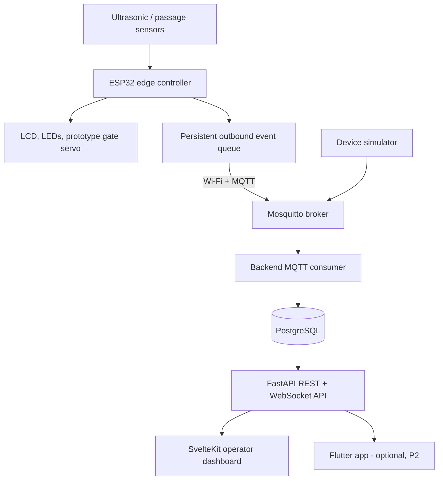
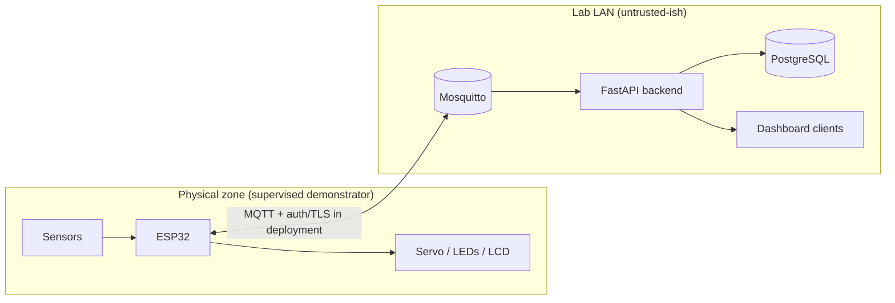

# Architecture overview

**Status:** target architecture for the SmartPark-IoT MVP; only the ESP32 edge
controller exists today (M0 baseline — see the component status table).
This document follows the project
[blueprint](../SMARTPARK_V2_COMPLETE_PROJECT_BLUEPRINT.md) §5.

## Components and data flow

| Component | Milestone | Status |
|---|---|---|
| ESP32 edge controller (sensing, local safety, display) | M0 baseline → M1 rework | 🟡 V1 logic building under PlatformIO |
| Persistent outbound event queue | M2 | ⬜ planned |
| Wi-Fi + MQTT transport (topics, IDs, heartbeat) | M2 | ⬜ planned |
| Mosquitto broker | M2 | ⬜ planned |
| FastAPI backend + PostgreSQL | M3 | ⬜ planned |
| SvelteKit dashboard | M4 | ⬜ planned |
| Device simulator | M5 | ⬜ planned |
| Flutter app | M10 (optional) | ⬜ planned |

## Ownership and trust boundaries

- **ESP32 owns physical safety.** Sensing, occupancy logic and gate behavior
  must work with Wi-Fi, broker and backend completely unavailable
  (NFR-001). Network loss must never cause unsafe actuation.
- **Backend owns normalized event records.** It validates, deduplicates
  (idempotent by `(device_id, event_id)`) and stores events; it never reaches
  into hardware directly.
- **Database owns persistence**; migrations are the source of truth.
- **Dashboard is a client, not a controller.** It displays state and requests
  authenticated operator actions; it cannot bypass device-local safety checks.

Trust boundaries (mermaid):

Everything crossing from the physical zone into the LAN is an *event or
heartbeat*, never raw actuator control from the internet. Operator commands
(future) are scoped, expiring, logged and validated locally by the ESP32.

## Failure-mode policy

| Failure | Expected behavior |
|---|---|
| Sensor timeout / stuck | State becomes `UNKNOWN`, health alert; never reported as "free" |
| Wi-Fi or broker down | Local operation continues; events queue durably; dashboard shows `OFFLINE`/stale, not fabricated freshness |
| Duplicate/reordered MQTT delivery | Idempotent ingest — exactly one stored logical event |
| Backend/DB down | API reports unavailable; device unaffected |
| ESP32 reboot | Safe startup; occupancy recovered from persistence or marked `UNKNOWN` until reconciled |
| Barrier obstruction | Gate FSM stops/reverses or latches `FAULT` (M1 design) — never blind timed close |

## Offline-first rationale

The demonstrator must be useful without internet connectivity and must not
corrupt its own occupancy state when connectivity flaps. That is why local
sensing + safety run entirely on the ESP32 (ADR-002), events carry durable
unique IDs (ADR-005), and "unknown" is a first-class state instead of assuming
free capacity (ADR-006). See
[`docs/decisions/0001-baseline.md`](../decisions/0001-baseline.md).

## Deployment variants

- **Development:** Docker Compose on a laptop (broker + DB + backend + frontend)
  — *does not exist yet; created in M3/M4/M5.*
- **Pilot:** local mini-PC/Raspberry Pi-class gateway running broker + backend,
  ESP32 controllers on the same LAN; optional cloud sync is a later decision.
- Internet connectivity is never a prerequisite for local operation.
